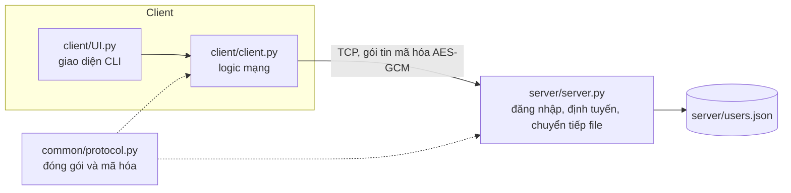

# Ứng dụng cộng tác Client-Server

Bài tập lớn môn Mạng Máy tính: chat và gửi file giữa nhiều client thông qua server.

## Tiến độ

- [x] Bước 1: thiết kế giao thức (`docs/protocol.md`)
- [x] Bước 2: handshake TCP cơ bản (client gửi `PING`, server trả `PONG`)
- [x] Bước 3: đa luồng
- [x] Bước 4: đăng nhập và quản lý người dùng
- [x] Bước 5: gửi tin nhắn chung và riêng
- [x] Bước 6: gửi file
- [x] Bước 7: xử lý lỗi và ngắt kết nối
- [x] Bước 8: mã hóa
- [x] Bước 9: giao diện CLI
- [x] Bước 10: test và dọn code

## Yêu cầu

- Python 3.8 trở lên.
- Thư viện: `cryptography` (mã hóa AES-GCM) và `prompt_toolkit` (giao diện CLI), có trong `requirements.txt`.
- Chạy được trên Windows, macOS, Linux. Client nên chạy trong PowerShell, CMD, Windows Terminal hoặc terminal của VS Code, không dùng Git Bash (mintty).

## Cách chạy

Chạy mọi lệnh từ thư mục gốc của repo (thư mục chứa `server/`, `client/`, `common/`).

1. Cài thư viện:
```
pip install -r requirements.txt
```

2. Chạy server (terminal 1). Mặc định cổng 5000, muốn đổi thì thêm số cổng:
```
python -m server.server
python -m server.server 6000
```

3. Chạy client (mỗi client một terminal riêng):
```
python -m client.client
```
Nhập tên đăng nhập và mật khẩu. Tên chưa có thì tự đăng ký. Mở 2-3 terminal với các tên khác nhau để thử.

4. Dùng các lệnh `/msg`, `/send`, `/users`, `/help`, `/quit` (xem mục Bước 9). Gõ chữ bình thường để chat chung.

Chạy trên nhiều máy trong cùng mạng LAN:
- Máy server: chạy `python -m server.server`, xem địa chỉ IP bằng `ipconfig` (Windows) hoặc `ifconfig` / `ip a` (macOS, Linux). Cho phép cổng 5000 qua firewall.
- Copy file `secret.key` từ máy server sang thư mục gốc repo trên mỗi máy client. Khác khóa thì client báo không giải mã được.
- Máy client: `python -m client.client <IP-server>`, có thể thêm cổng: `python -m client.client 192.168.1.10 6000`.

Nếu gõ `python` không chạy được thì thử `py`.

## Bước 4: đăng nhập và quản lý người dùng

Client phải đăng nhập bằng gói `AUTH` trước khi làm gì khác. Server giữ list người online trong dict `clients` (username -> session), có `Lock` để các thread không giẫm chân nhau khi cùng sửa dict này.

Luật đăng nhập:
- Tên chưa có trong `server/users.json` thì tự đăng ký, mật khẩu lưu dạng hash SHA-256 (chưa salt, đơn giản hóa cho bài tập).
- Tên đã có thì so mật khẩu, sai trả `AUTH_FAIL` với lý do `Sai mật khẩu`.
- Tên đang online ở client khác trả `AUTH_FAIL` với lý do `Tên đã được dùng`.
- Tên không hợp lệ khi không phải chữ/số, dài hơn 20 ký tự, hoặc trùng `ALL` (vì `ALL` là đích của chat chung).
- Chưa đăng nhập mà gửi gói khác `AUTH` thì nhận `ERROR` với mã `NOT_AUTHENTICATED`.
- Mỗi lần có người vào hoặc ra, server broadcast `USERS` cho tất cả client đang online.
- Server lưu IP và cổng của từng kết nối (`Session.addr`) và in ra console mỗi lần có người vào hoặc ra, ví dụ `[i] Đang online: phu (127.0.0.1:50123)`.

Client sau khi đăng nhập có thêm một thread riêng để nghe gói từ server, nên danh sách online tự cập nhật mà không cần gõ lệnh. Lệnh hiện có:
- `/users`: xin danh sách người online
- `/quit`: gửi `BYE` rồi thoát

Mỗi kết nối có một `send_lock` riêng (class `Session`), vì nhiều thread có thể cùng gửi vào một socket (ví dụ broadcast `USERS` trong lúc thread của client đó đang trả lời). Không có lock thì 2 gói có thể bị trộn byte vào nhau.

Cách test:
- Mở 1 terminal chạy server.
- Mở 2 terminal chạy client, đăng nhập 2 tên khác nhau. Client thứ nhất tự in ra list mới khi client thứ hai vào.
- Thử đăng nhập trùng tên, sai mật khẩu, tên `ALL` để xem `AUTH_FAIL`.
- Bấm Ctrl+C ở một client thì client kia nhận list mới không còn tên đó.

Lưu ý:
- `server/users.json` chứa hash mật khẩu nên không commit, đã thêm vào `.gitignore`.
- Mật khẩu được mã hóa trên đường truyền từ bước 8. Hash trong `users.json` vẫn chưa salt.

## Bước 5: nhắn tin chung và riêng

Dùng gói `MSG` với trường `to`:
- `to = "ALL"`: chat chung, server forward cho tất cả người đang online trừ người gửi.
- `to = <tên>`: chat riêng, server chỉ forward cho người đó. Người nhận không online thì server trả `ERROR` với mã `USER_OFFLINE`.
- Server tự điền `from` theo người đã đăng nhập trên kết nối đó, không tin `from` do client gửi, nên không giả mạo được người gửi.
- `MSG` thiếu `to` hoặc `text` rỗng thì trả `ERROR` với mã `BAD_PACKET`.

Lệnh ở client:
- Gõ chữ bình thường rồi Enter: chat chung.
- `/msg <tên> <nội dung>`: chat riêng.
- `/users`, `/quit` như bước 4.

Tin nhận được hiện dạng `[Chung] nam: ...` hoặc `[Riêng] nam: ...`.

Khi forward, server tìm `Session` của người nhận trong `clients` rồi gửi bằng `send_lock` riêng của kết nối đó, nên nhiều người chat cùng lúc vẫn không bị trộn byte.

Cách test:
- Chạy server, mở 3 client với 3 tên khác nhau (ví dụ phu, nam, lam).
- phu gõ chữ bình thường: nam và lam đều nhận `[Chung]`, phu không nhận lại tin của chính mình.
- phu gõ `/msg nam ...`: chỉ nam nhận `[Riêng]`, lam không thấy gì.
- phu gõ `/msg ghost ...`: nhận lỗi người nhận không online.

## Bước 6: gửi file

Gửi file bằng 3 loại gói như trong `protocol.md`: `FILE_START` (tên file, kích thước, người nhận), nhiều `FILE_CHUNK` (mỗi mảnh 4096 byte, mã hóa base64), rồi `FILE_END` kèm SHA-256 của cả file.

Lệnh ở client: `/send <tên> <đường dẫn file>`. Chỉ gửi cho một người, không gửi `ALL`. Đường dẫn có dấu cách thì cứ gõ bình thường hoặc để trong dấu ngoặc kép.

Server không lưu file, chỉ forward. Khi nhận `FILE_START`, server ghi nhớ ai gửi cho ai trong dict `transfers` (key là `(người gửi, file_id)`), vì `FILE_CHUNK` và `FILE_END` không có trường `to` nên cần biết chuyển tiếp cho đúng người. Key có cả người gửi nên người khác không chen vào được file đang gửi của người ta.

Bên nhận ghi từng mảnh xuống file tạm `.part` trong thư mục `downloads/`, tính SHA-256 dần theo từng mảnh. Nhận `FILE_END` thì so SHA-256 và kích thước:
- Khớp: đổi tên file tạm thành tên thật (trùng tên thì thêm `(1)`, `(2)`...).
- Không khớp: xóa file tạm, báo file bị hỏng.

Các trường hợp đã xử lý:
- Tên file người gửi cung cấp bị cắt phần đường dẫn (`../../x` thành `x`), nên không ghi ra ngoài `downloads/` được.
- Mảnh phải đến đúng thứ tự `seq`, sai thì hủy file đang nhận.
- Người gửi ngắt kết nối giữa chừng: server báo `ERROR` mã `FILE_ERROR` cho người nhận, bên nhận xóa file tạm.
- Người nhận ngắt kết nối giữa chừng: server báo `FILE_ERROR` cho người gửi, client gửi tự dừng.
- Client nhận thoát giữa chừng (kể cả Ctrl+C): file tạm đang nhận dở bị xóa.
- Gửi cho người không online: client chặn luôn từ đầu, không gửi gì.
- File rỗng (0 byte) và tên file tiếng Việt có dấu vẫn gửi được.

Khi đang gửi file, luồng chính của client bận nên chưa gõ lệnh khác được, nhưng vẫn nhận tin nhắn bình thường vì có thread nghe riêng.

Cách test:
- Chạy server, mở 2 client (ví dụ phu và nam).
- phu gõ `/send nam C:\Users\...\baocao.pdf`. phu thấy phần trăm tăng dần, nam thấy thông báo bắt đầu và kết thúc.
- Mở `downloads/` trong thư mục chạy client của nam, so sánh file với bản gốc (kích thước bằng nhau, mở được bình thường).
- Thử file vài MB, thử gửi cho tên không online, thử đường dẫn sai.
- Đang gửi file lớn thì đóng client nam, phu phải thấy `Gửi file bị hủy`.

Lưu ý: `downloads/` chứa file nhận được nên không commit, đã thêm vào `.gitignore`.

## Bước 7: xử lý lỗi và ngắt kết nối

Server không được crash dù client làm gì. Mỗi client chạy trong một thread riêng, lỗi của client nào chỉ ảnh hưởng đúng thread đó.

Ngắt kết nối:
- Client thoát đột ngột (rút mạng, đóng cửa sổ, Ctrl+C): server bắt `OSError` (gồm `ConnectionResetError`, `BrokenPipeError`, `TimeoutError`), xóa khỏi list online, hủy các file đang truyền dở, broadcast `USERS` mới.
- Gửi vào một kết nối bị lỗi thì `Session.send` đóng luôn kết nối đó, tránh để stream bị lệch giữa chừng một gói.
- Heartbeat: server gửi `PING` cho mọi client đã đăng nhập mỗi 15 giây, client tự trả `PONG`. Quá 30 giây không nhận được gì thì server coi như mất kết nối. Chưa đăng nhập thì chờ tối đa 120 giây.
- Client cũng có timeout 45 giây: không thấy `PING` của server thì báo mất kết nối, bấm Enter để thoát.
- Client bắt `Ctrl+C` hoặc EOF, gửi `BYE` rồi thoát gọn. Server tắt bằng Ctrl+C thì in `Server đã dừng`.
- Mở client khi chưa chạy server thì báo `Không kết nối được`, không in traceback.

Gói sai:
- JSON hỏng, không phải object, thiếu `type`, sai kiểu dữ liệu, loại gói lạ: server trả `ERROR` mã `BAD_PACKET` và giữ kết nối. Quá 5 gói lỗi thì ngắt.
- Gói lớn hơn 1 MB: trả `PACKET_TOO_LARGE` rồi ngắt luôn, vì không đọc hết phần thân nên không đồng bộ lại stream được.
- `FILE_START` có `size` âm, sai kiểu, hoặc vượt 100 MB thì bị từ chối bằng `FILE_ERROR`. Bên nhận hủy file nếu nhận nhiều hơn `size` đã khai báo, hoặc không ghi được xuống đĩa.

Một số thay đổi khác:
- Client có `send_lock` riêng, vì thread nghe tự trả `PONG` xen giữa các mảnh file do luồng chính đang gửi.
- `username` lưu trong `Session`, nên đăng nhập dở giữa chừng không còn để lại "ma" trong list online.
- `common/protocol.py` có thêm `PacketTooLarge` để server phân biệt gói quá lớn với gói hỏng thông thường.

Cách test:
- Chạy server, mở 2 client rồi để yên hơn 1 phút. Cả hai vẫn online vì tự trả `PONG`.
- Đóng đột ngột cửa sổ một client: client kia nhận list mới, server không báo lỗi.
- Bấm Ctrl+C ở client: client in `Đã thoát`, client kia nhận list mới.
- Tắt server bằng Ctrl+C: in `Server đã dừng`. Client đang mở sẽ báo mất kết nối.
- Chạy client khi chưa bật server: nhận thông báo `Không kết nối được`.

## Bước 8: mã hóa

Mã hóa toàn bộ nội dung mọi gói tin bằng AES-256-GCM (thư viện `cryptography`). Server và client dùng chung một khóa lưu trong file `secret.key` ở thư mục gốc.

Cài thư viện:
```
pip install -r requirements.txt
```

Khung gói tin sau khi mã hóa:
```
+--------------+----------------+----------------------------+
| 4 byte (N)   | 12 byte nonce  | ciphertext + 16 byte tag   |
+--------------+----------------+----------------------------+
```
`N` là độ dài của phần nonce + ciphertext + tag. Header 4 byte vẫn để rõ vì bên nhận cần biết đọc bao nhiêu byte.

- Mỗi gói dùng một nonce ngẫu nhiên 12 byte, gửi kèm ngay đầu gói.
- GCM vừa mã hóa vừa có tag xác thực, nên gói bị sửa dù chỉ 1 bit hoặc dùng sai khóa đều giải mã thất bại (`DecryptError`).
- Server giải mã thất bại thì xử lý như `BAD_PACKET` ở bước 7 (trả lỗi, quá 5 lần thì ngắt). Client giải mã thất bại thì báo kiểm tra lại `secret.key`.
- Mật khẩu đăng nhập, nội dung chat và file đều được mã hóa trên đường truyền.

Quản lý khóa:
- Lần đầu chạy, nếu chưa có `secret.key` thì tự sinh khóa 256 bit ngẫu nhiên.
- Server và client trên cùng một máy thì dùng chung file này luôn. Khác máy thì copy `secret.key` từ máy server sang máy client, không gửi qua kênh công khai.
- `secret.key` không được commit, đã thêm vào `.gitignore`.

Hạn chế (ghi lại để bảo vệ):
- Khóa dùng chung cho mọi người, ai có file `secret.key` đều giải mã được. Chưa có trao đổi khóa riêng cho từng kết nối như TLS.
- Chưa chống replay: kẻ nghe lén có thể gửi lại nguyên một gói đã bắt được. Muốn chống thì cần thêm số thứ tự gói hoặc timestamp.

Cách test:
- Cài thư viện, chạy server và 2 client như thường. Chat và gửi file vẫn bình thường.
- Xóa `secret.key` ở thư mục của một client (máy khác) rồi chạy lại: khóa mới sinh ra khác server, client báo không giải mã được.
- Muốn thấy dữ liệu bị mã hóa thì bắt gói trên loopback bằng Wireshark, nội dung chỉ là byte ngẫu nhiên, không đọc được chữ nào.

## Bước 9: giao diện CLI

Giao diện chạy trong terminal, dùng thư viện `prompt_toolkit` (cài bằng `pip install -r requirements.txt`). Chạy trong PowerShell, CMD hoặc terminal của VS Code, không chạy được trong Git Bash (mintty).

Code giao diện tách riêng ở `client/UI.py` (class `ChatUI`), còn `client/client.py` chỉ lo phần mạng rồi gọi `UI` để hiển thị.

Giao diện gồm:
- Dòng nhập `phu> ` ở dưới cùng. Tin nhắn mới tới được in phía trên dòng này, không làm hỏng chữ đang gõ dở (nhờ `patch_stdout`).
- Thanh trạng thái (bottom toolbar) luôn hiện danh sách người online và progress bar của file đang gửi (↑) hoặc đang nhận (↓), cập nhật mỗi 0.3 giây.
- Mỗi dòng có giờ `[HH:MM]`. Tin chung hiện `tên: nội dung` (mỗi người một màu), tin riêng hiện `A → bạn (riêng)`, tin của chính mình hiện `bạn: ...`, thông báo hệ thống bắt đầu bằng `***`, lỗi màu đỏ.
- Thông báo `*** nam đã vào` hoặc `*** nam đã thoát` tạo ra bằng cách so danh sách `USERS` mới với danh sách cũ.
- Bấm Tab để gợi ý lệnh (`/msg`, `/send`...) và tên người dùng đang online.

Lệnh:
- Gõ chữ bình thường: chat chung.
- `/msg <tên> <nội dung>`: nhắn riêng.
- `/send <tên> <đường dẫn>`: gửi file.
- `/users`, `/help`, `/clear`, `/quit` (hoặc Ctrl+C, Ctrl+D).

Thay đổi so với các bước trước:
- Gửi file chạy trong thread riêng, nên vừa gửi vừa gõ lệnh hoặc chat bình thường được.
- `/users` đọc danh sách có sẵn ở client (server tự broadcast mỗi khi có người vào hoặc ra), không cần hỏi lại server.
- `/msg` và `/send` cho người không online thì chặn ngay ở client.
- Mất kết nối tới server thì client tự thoát khỏi dòng nhập, không cần bấm Enter.

Cách test:
- Cài thư viện, chạy server và 2 client (`phu`, `nam`) trong 2 terminal.
- `nam` vào thì `phu` thấy `*** nam đã vào`, thanh trạng thái hiện `Online (2): nam, phu`.
- Gõ chữ thường, `/msg nam ...`, `/users`, `/help`, thử Tab sau khi gõ `/ms` hoặc `/msg na`.
- `phu` gửi một file vài chục MB cho `nam`: cả hai thấy progress bar chạy ở thanh dưới cùng, trong lúc đó `phu` vẫn chat được.
- Đóng client `nam` thì `phu` thấy `*** nam đã thoát`.

## Bước 10: test và chất lượng code

Chạy toàn bộ test tự động (khoảng 10 giây):
```
python -m unittest discover -s tests -v
```

Các file test trong `tests/`:
- `test_protocol.py`: đóng gói, mã hóa AES-GCM (không lộ chữ trên đường truyền, sửa 1 bit hoặc sai khóa thì bị từ chối, gói quá ngắn hoặc quá lớn).
- `test_server.py`: chạy server thật trên cổng ngẫu nhiên với file tài khoản tạm, rồi kết nối bằng socket. Gồm đăng nhập, chat chung và riêng, gửi file, gói sai định dạng, client rớt đột ngột, heartbeat, và 20 client chat cùng lúc.
- `test_client.py`: nhận file (SHA-256, thứ tự mảnh, chống path traversal, trùng tên), cập nhật danh sách online, hàm hỗ trợ giao diện.

Test thủ công nhiều terminal (mô phỏng mạng cục bộ):
- Mở 1 terminal chạy server, 3 terminal chạy client với 3 tên khác nhau.
- Chat chung, chat riêng, gửi file vài chục MB, quan sát progress bar và danh sách online.
- Đóng đột ngột một client (đóng cửa sổ terminal): server không crash, các client còn lại thấy `*** ... đã thoát`.
- Tắt server bằng Ctrl+C: các client tự báo mất kết nối.

Chất lượng code:
- Code tách 3 phần: mạng (`common/protocol.py`, `server/server.py`, phần xử lý gói trong `client/client.py`), xử lý dữ liệu (đăng nhập, định tuyến, ghép file) và giao diện (`client/UI.py`).
- Các hàm và những chỗ khó (`Lock`, `send_lock`, base64, nonce của AES-GCM...) đều có comment giải thích bằng tiếng Việt. Code được format bằng `black` (độ dài dòng 100) và kiểm tra bằng `ruff`.

## Kiến trúc tổng quan



## Cấu trúc thư mục

```
network-assignment-1/
├── server/
│   └── server.py
├── client/
│   ├── client.py        # logic mạng của client
│   └── UI.py            # giao diện CLI
├── common/
│   └── protocol.py      # đóng gói, mã hóa AES-GCM và đọc gói dùng chung
├── tests/
│   ├── test_protocol.py
│   ├── test_server.py
│   └── test_client.py
├── docs/
│   └── protocol.md      # đặc tả giao thức
├── requirements.txt     # cryptography, prompt_toolkit
├── .gitignore
└── README.md
```

File tự sinh khi chạy, đã có trong `.gitignore` nên không commit:
- `secret.key` (thư mục gốc): khóa AES dùng chung giữa server và client.
- `server/users.json`: tài khoản đã đăng ký, mật khẩu lưu dạng hash.
- `downloads/` (thư mục chạy client): file nhận được.
- `__pycache__/`: cache của Python.