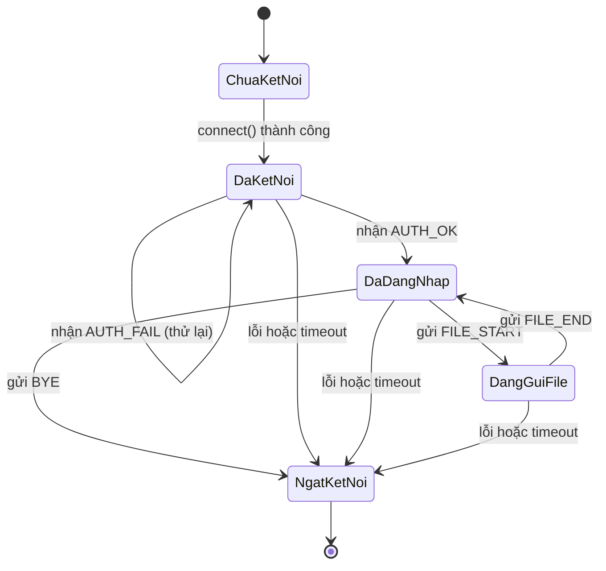
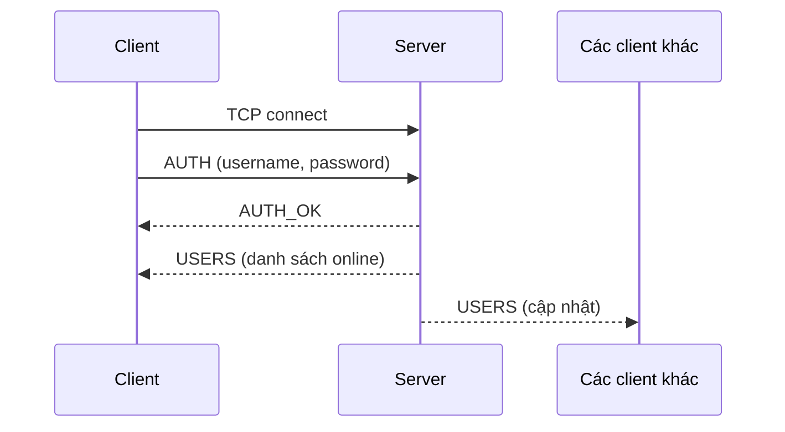
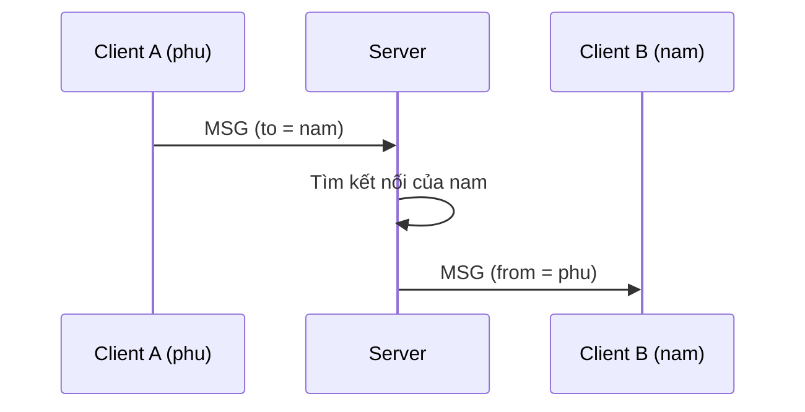
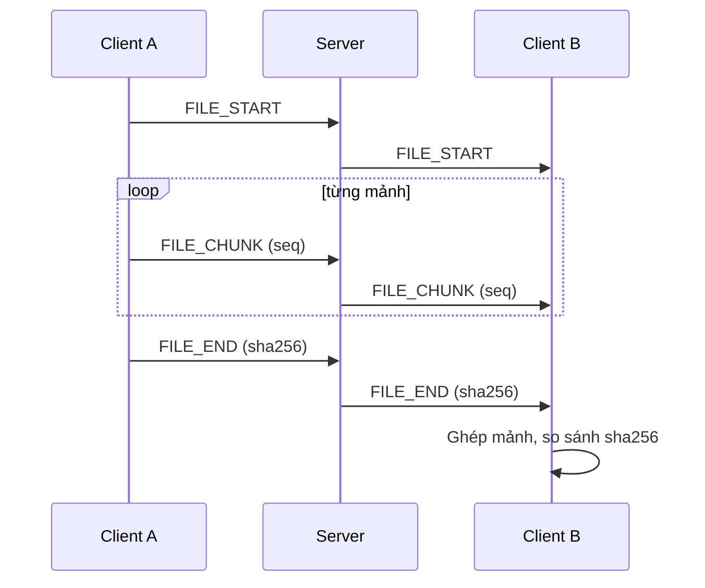

# Mô tả giao thức – ứng dụng client-server

Tài liệu này mô tả cách mà client và server dùng để nói chuyện với nhau. Mọi code đều follow tài liệu này.

## 1. Tổng quan

- **Ngôn ngữ:** Python 3, chỉ dùng thư viện `socket` và `threading`.
- **Giao vận:** TCP cho mọi thứ như đăng nhập, chat, gửi file vì TCP đảm bảo dữ liệu đến đủ và đúng thứ tự.
- **Kiến trúc:** Mô hình client-server. Server giữ list người online và forward tin nhắn, file giữa các client.
- **Cổng mặc định:** `5000`.
- **Mã hóa ký tự:** UTF-8.

## 2. Khung gói tin (framing)

Vì TCP là một dòng byte liên tục, không tự chia ranh giới giữa các gói nên mỗi gói tin có **2 phần**:

```
+----------------------+------------------------------+
|  4 byte (độ dài N)   |  N byte nội dung (JSON UTF-8) |
+----------------------+------------------------------+
```

- **4 byte đầu**: số nguyên không dấu, thứ tự byte big-endian (`struct.pack('>I', N)`), cho biết phần nội dung dài bao nhiêu byte.
- **Nội dung**: một chuỗi JSON, mô tả gói tin.
- Bên nhận làm theo 2 bước: đọc đúng 4 byte để biết `N`, rồi đọc đúng `N` byte tiếp theo. Nếu `recv` trả về thiếu thì phải đọc tiếp cho đủ.
- **Độ dài tối đa** của một gói: 1 MB. Gói lớn hơn bị từ chối bằng `ERROR`.

Mọi JSON đều có trường bắt buộc:

| Trường | Kiểu | Ý nghĩa |
| --- | --- | --- |
| `type` | chuỗi | Loại gói tin |

## 3. Các loại gói tin

### 3.1. Đăng nhập

**`AUTH`** (client → server): xin đăng nhập.
```json
{"type": "AUTH", "username": "phu", "password": "123456"}
```

**`AUTH_OK`** (server → client): đăng nhập thành công.
```json
{"type": "AUTH_OK", "message": "Chào mừng phu"}
```

**`AUTH_FAIL`** (server → client): đăng nhập thất bại.
```json
{"type": "AUTH_FAIL", "reason": "Sai mật khẩu"}
```
Các lý do thường gặp: `Sai mật khẩu`, `Tên đã được dùng`, `Tên không hợp lệ`.

### 3.2. Danh sách người dùng

**`USERS`** (server → client): danh sách người đang online. Server gửi khi có người vào, ra hoặc khi client yêu cầu.
```json
{"type": "USERS", "users": ["phu", "nam", "lam"]}
```

**`GET_USERS`** (client → server): xin danh sách mới nhất.
```json
{"type": "GET_USERS"}
```

### 3.3. Nhắn tin

**`MSG`**: dùng cho cả chat chung và chat riêng.
```json
{"type": "MSG", "from": "phu", "to": "ALL", "text": "Chào mọi người"}
```
```json
{"type": "MSG", "from": "phu", "to": "nam", "text": "Tối nay nghỉ học nhé"}
```
- `to = "ALL"`: server gửi cho tất cả mọi người đang online (trừ người gửi).
- `to = <tên người>`: server chỉ chuyển cho người đó. Nếu người đó không online, server trả `ERROR` với mã `USER_OFFLINE`.
- Server tự điền lại `from` theo người đã đăng nhập trên kết nối đó, không tin `from` do client gửi, để tránh giả mạo.

### 3.4. Gửi file

File được chia thành nhiều mảnh (chunk) và gửi qua 3 loại gói. Server chuyển tiếp các gói này tới người nhận.

**`FILE_START`**: báo sắp gửi file.
```json
{"type": "FILE_START", "from": "phu", "to": "nam", "file_id": "f1a2b3",
 "filename": "baocao.pdf", "size": 2048576, "chunk_size": 4096}
```
- `file_id`: mã riêng cho lần gửi này, để phân biệt nhiều file gửi cùng lúc.
- `size`: kích thước file tính bằng byte.

**`FILE_CHUNK`**: một mảnh của file.
```json
{"type": "FILE_CHUNK", "file_id": "f1a2b3", "seq": 0, "data": "<base64>"}
```
- `seq`: số thứ tự mảnh, bắt đầu từ 0.
- `data`: dữ liệu mảnh được mã hóa base64 để nhét vừa vào JSON. Base64 làm dữ liệu tăng khoảng 33%, trade-off để giao thức đơn giản.

**`FILE_END`**: báo gửi xong, kèm mã kiểm tra.
```json
{"type": "FILE_END", "file_id": "f1a2b3", "sha256": "ab12...ef"}
```
- Bên nhận ghép các mảnh theo `seq`, tính SHA-256 của file vừa ghép rồi so với `sha256`. Khớp nghĩa là file OK.

### 3.5. Kiểm tra kết nối và thoát

**`PING`** / **`PONG`**: kiểm tra xem bên kia còn sống không.
```json
{"type": "PING"}
{"type": "PONG"}
```
Server gửi `PING` định kỳ (ví dụ 15 giây). Client không trả `PONG` trong 30 giây thì server coi như mất kết nối và dọn dẹp.

**`BYE`** (client → server): thoát lịch sự.
```json
{"type": "BYE"}
```

### 3.6. Báo lỗi

**`ERROR`** (server → client):
```json
{"type": "ERROR", "code": "USER_OFFLINE", "message": "Người nhận không online"}
```

| Mã lỗi | Ý nghĩa |
| --- | --- |
| `NOT_AUTHENTICATED` | Gửi lệnh khi chưa đăng nhập |
| `USER_OFFLINE` | Người nhận không online |
| `BAD_PACKET` | Gói sai định dạng hoặc thiếu trường |
| `PACKET_TOO_LARGE` | Gói vượt quá 1 MB |
| `FILE_ERROR` | Lỗi trong quá trình gửi file |

## 4. Quy tắc trạng thái của client



Giải thích ngắn:
- **Chưa kết nối**: vừa mở chương trình.
- **Đã kết nối**: TCP đã nối nhưng chưa đăng nhập. Ở trạng thái này server chỉ chấp nhận `AUTH`.
- **Đã đăng nhập**: được chat, xin danh sách, bắt đầu gửi file.
- **Đang gửi file**: vẫn nhận được tin nhắn khác trong lúc gửi.
- **Ngắt kết nối**: server xóa người dùng khỏi danh sách và báo cho các client khác.

## 5. Luồng hoạt động mẫu

### 5.1. Đăng nhập



### 5.2. Gửi một tin nhắn riêng



### 5.3. Gửi file



## 6. Bảo mật

- Mã hóa **phần nội dung JSON** trước khi gửi, giải mã sau khi nhận. Phần 4 byte độ dài vẫn để nguyên và tính theo độ dài **sau khi mã hóa**.
- Dự kiến dùng AES-GCM (thư viện `cryptography`) với khóa chung của hệ thống. GCM vừa mã hóa vừa phát hiện dữ liệu bị sửa.
- Mỗi gói dùng một `nonce` riêng, gửi kèm đầu phần nội dung đã mã hóa.

## 7. Xử lý lỗi và ngắt kết nối

- Client thoát đột ngột (rút mạng, đóng cửa sổ): server bắt ngoại lệ (`ConnectionResetError`, `BrokenPipeError`, `socket.timeout`), xóa người dùng khỏi danh sách, đóng socket, báo `USERS` mới cho mọi người. Server không được crash.
- Gói sai định dạng: server trả `ERROR` với mã `BAD_PACKET` và giữ kết nối, trừ khi lỗi lặp lại nhiều lần.
- Mất kết nối giữa chừng khi gửi file: bên nhận hủy file đang ghép dở và xóa file tạm.

## 8. Cấu trúc thư mục dự kiến

```
network-assignment-1/
├── server/
│   └── server.py
├── client/
│   └── client.py
├── common/
│   └── protocol.py      # hàm đóng gói và đọc gói dùng chung
├── docs/
│   └── protocol.md      # you're right HERE
├── README.md
└── notes.txt
```
